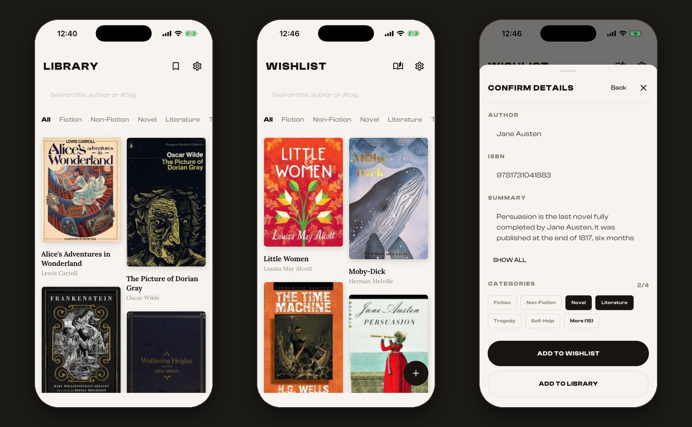

# DRAFT.

I made this for one question in a bookstore with no signal: do I already own this book? DRAFT keeps your books on the phone, searches them offline, and fills in covers and summaries from Google Books when there is a connection.




## What it does

- Two shelves: **Library** for books you own and **Wishlist** for books you want
- Type a title and pick from Google Books results; the cover, author, ISBN and summary come with it
- Instant offline search over titles, authors and summaries
- A search box that understands `#tag` and `:owned` / `:wishlist` along with plain words
- Each book's page takes its background colour from its cover
- Drag to reorder the wishlist; deleted books can be restored before they expire
- Back up the whole catalogue as one zip through the share sheet, and restore it

## How it is built

- **Search is SQLite FTS5.** An FTS5 table over title, author and summary is kept in sync by three triggers, so search never leaves the phone and never goes stale.
- **The database enforces its own rules.** Two `BEFORE` triggers stop a wishlist book from being marked as a favourite or given a reading status, and tests check that such inserts throw. A book always keeps at least one category and falls back to "Uncategorized". WAL mode and foreign keys are on.
- **Reordering writes one row.** Wishlist order is a fractional `sort_order`, so a drag inserts at the midpoint between neighbours instead of renumbering the list.
- **Covers are processed off the UI thread.** A background isolate makes a thumbnail and a full-size JPEG, and `palette_generator` picks the page colour.
- **Network calls give up fast.** Google Books requests time out after 4 s, and the last 50 queries are cached in memory.
- **Layout:** feature folders (`library`, `add_book`, `book_detail`, `settings`) over a `data/` layer of Drift DAOs and repositories, with Riverpod streams from the database to the UI.

36 tests: 20 for the search-box parser and 16 for the repository, run against an in-memory SQLite database. All 36 pass (`flutter test`, 25 Nov 2026).

## Run it

You need your own Google Books API key.

```bash
git clone https://github.com/ukasha167/DRAFT.git
cd DRAFT
echo "const googleBooksApiKey = 'YOUR_API_KEY';" > lib/api_keys.dart
flutter pub get
dart run build_runner build --delete-conflicting-outputs
flutter run
```

## Privacy

Your catalogue lives in a SQLite file on the phone. There are no accounts. The titles you look up are sent to Google Books, and nothing else leaves the phone.
